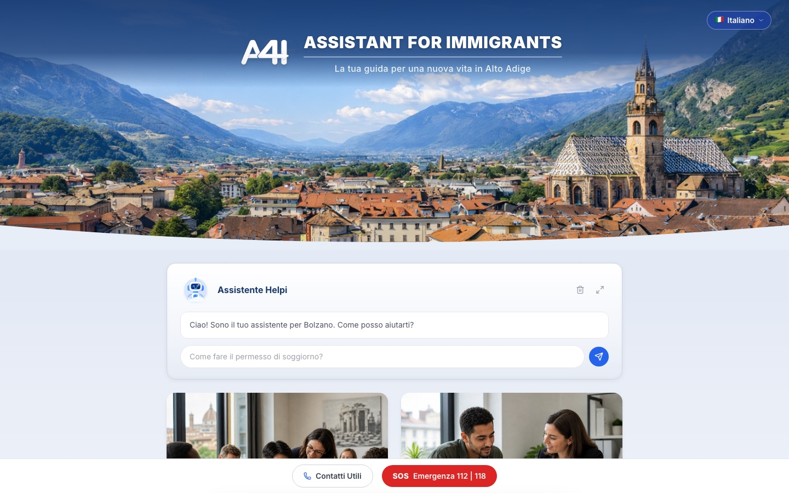
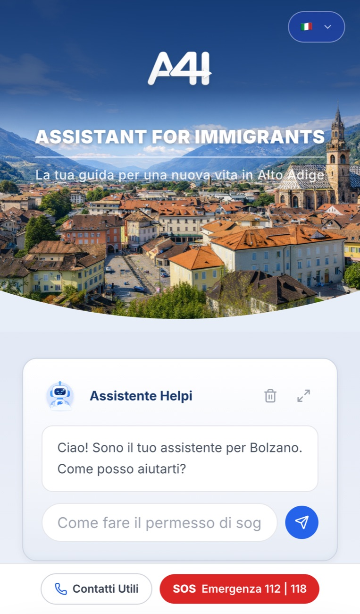

# A4I — Assistant for Immigrants in Bolzano

  

👉 **Try it:** https://bolzano-migrant-help.vercel.app

A multilingual web app that helps newcomers to Bolzano (Alto Adige / South Tyrol, Italy) find their
way around local bureaucracy and services: residence permits, documents, housing, jobs, health care,
language schools and transport — with an AI assistant that answers questions in the user's own
language.

**Author:** Mykhailo Koniev · [LinkedIn](https://linkedin.com/in/mykhailo-koniev)

  
  &nbsp;
  

> This repository is a project showcase. The source code is kept private; it can be shown on
> request, for example during a job interview.

## Features

- **AI assistant "Helpi"** — answers questions such as "How do I get a permesso di soggiorno?"
  with links to the right offices. Detects the language of the question and replies in it.
- **Provider fallback chain** — Google Gemini first, then Groq (Llama 3) and OpenRouter if a quota
  runs out or a model fails, so the assistant keeps working on free tiers.
- **Guides by topic** — documents (permesso di soggiorno, residence, identity, tax code, family),
  housing (public, private, free shelters), jobs and worker services, health (SSN, pharmacies,
  emergencies, prevention, support), language schools and courses, local transport and trains.
- **5 interface languages** — Italian, English, German, Spanish and Ukrainian.
- **Emergency bar** — one-tap access to 112 / 118 and a list of useful local contacts.
- **Mobile first and installable** — responsive layout, PWA manifest, safe-area support for iOS.

## Tech stack

Next.js (App Router) · React · TypeScript · Tailwind CSS · Google Gemini API · Groq API ·
OpenRouter · franc (language detection) · lucide-react · Vercel

## How it works

- Content for every section and all interface translations live in typed data modules, so pages
  are generated from data instead of hard-coded markup.
- The AI assistant runs in a server-side API route: API keys never reach the browser. The route
  detects the user's language, builds a Bolzano-specific prompt and tries the providers in order
  until one answers.
- The site is deployed on Vercel with automatic deployments from the main branch.

## License

Copyright © 2026 Mykhailo Koniev. **All rights reserved.** The text, screenshots and design shown
here may not be reused without written permission. See [LICENSE](LICENSE).
